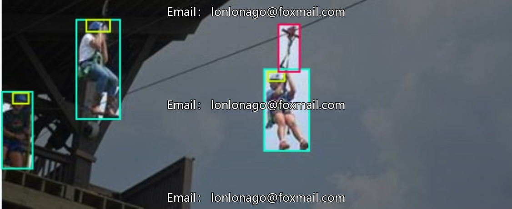
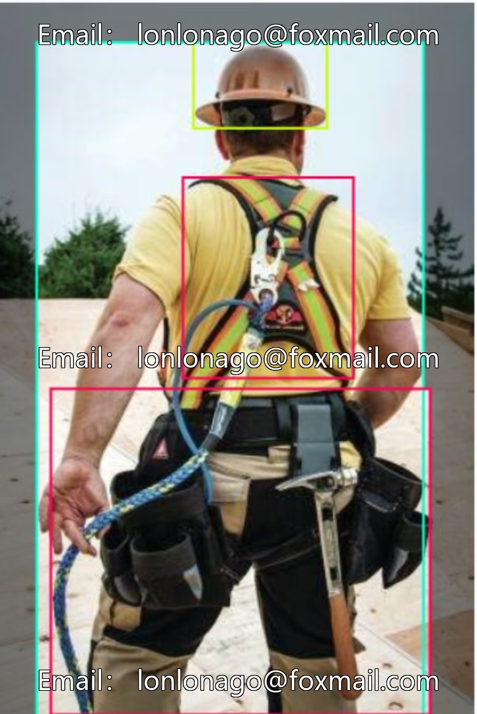
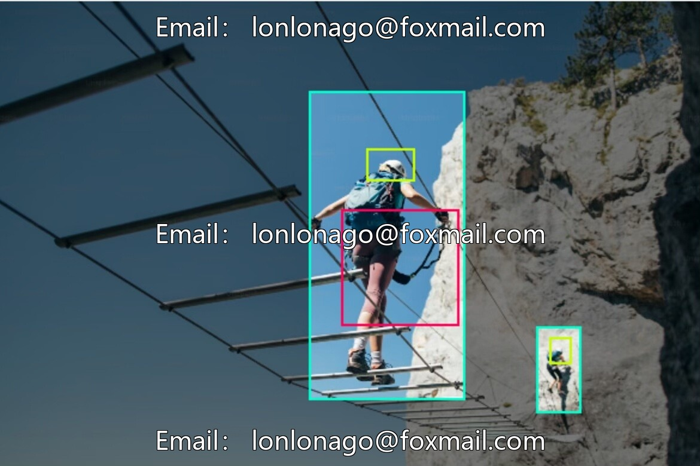
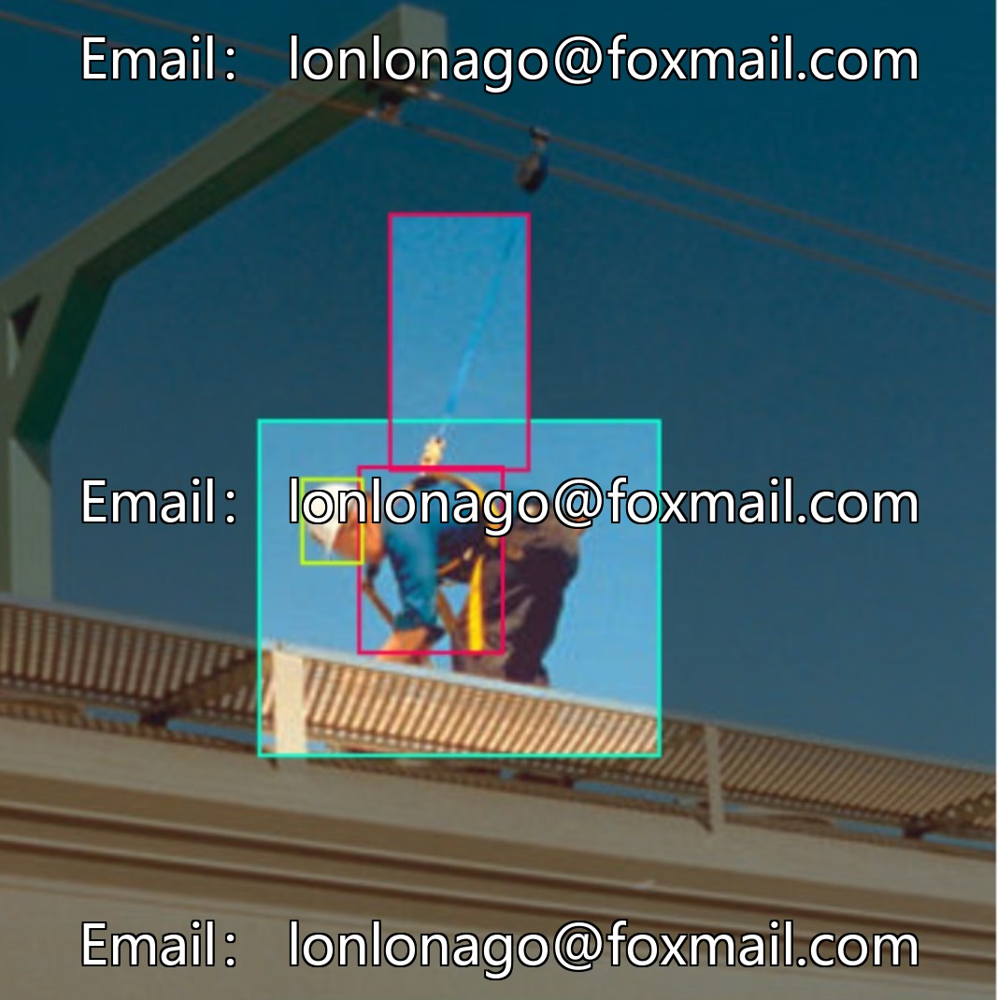
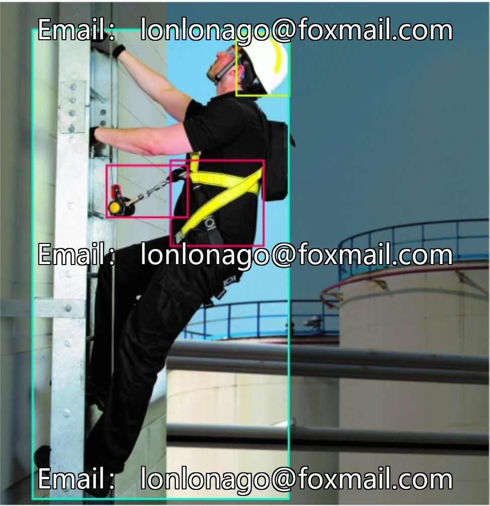
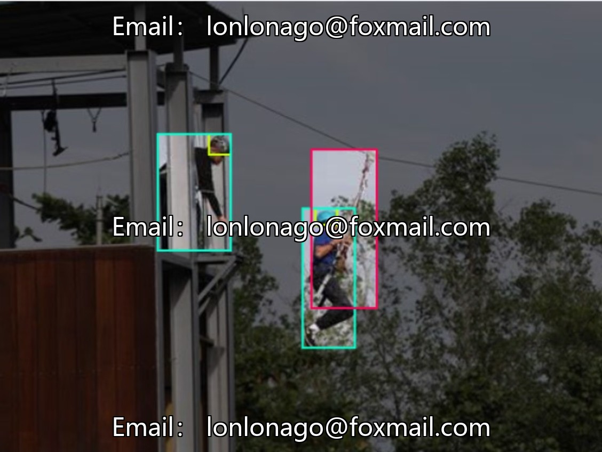
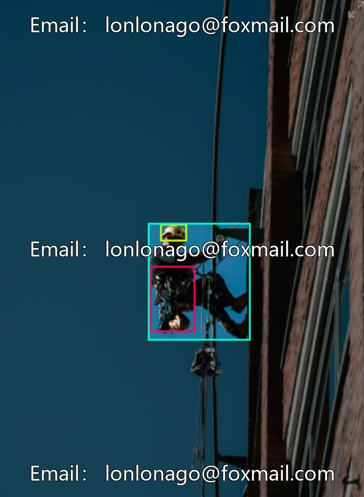
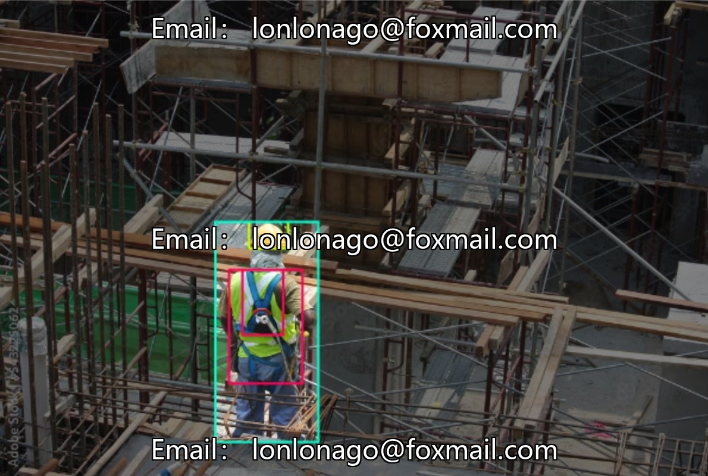

# Intelligent Safety Monitoring - High-altitude Work Safety Harness Identification Image Dataset, Construction Site Safety Caps

## Body

Intelligent Safety Monitoring - High-altitude Workplace Harness Identification Image Dataset, Construction Site Safety Cap and Gloves Wearing, Reflective Clothing Identification, Clothing Image Dataset, Issue 10242

The dataset contains 110 images, with 4 core categories: Harness, Head, Helmet, Person. It supports the training and validation of target detection models, suitable for manufacturing industry safety compliance inspections, recognizing personnel wearing safety equipment, and reducing accident risks.

Data is presented in image file format, compatible with mainstream computer vision model training needs, facilitating annotation and processing.

Virtual materials, once sold, are non-refundable.
Interested friends, click "I want" to proceed.

## Images

## Payment

Here is a pay link on Stripe ( https://buy.stripe.com/3cs8yP7sY87d0vu9AB ). Please contact me lonlonago@foxmail.com after funding $89, and I will send you a complete data files , thank you!

